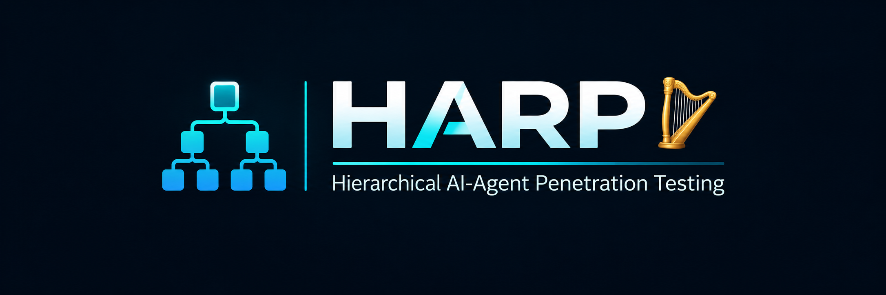

# HARP

  

HARP is a hierarchical AI-agent penetration-testing prototype for authorized labs. An oracle reviews deterministic reconnaissance and delegates objectives to a proxy model. HARP validates proposed commands, executes them through a logged Kali runtime, and records terminal evidence, artifacts, and outcomes. Hosted oracles can plan and delegate automatically; Codex operates through the HARP MCP tools.

For complex work, a hosted oracle can provide an exact implementation for the proxy to execute, and the proxy can request oracle help when it encounters a blocker. Z.AI GLM-5.3 and GLM-5.3-Flash sessions can use configurable oracle evidence depth and larger token ceilings; see [GLM configuration](docs/configuration.md#zai-api--glm) for practical starting settings.

## Supported configurations

| Component | Options |
| --- | --- |
| Oracle | OpenAI API, Z.AI API, NVIDIA NIM, or Codex via MCP |
| Proxy model | OpenAI API, Z.AI API, NVIDIA NIM, or local Unsloth |
| Kali runtime | Existing Kali WSL or disposable Docker container |
| Experiment mode | Hybrid, proxy only, or frontier only |

## Getting started

1. Follow [Setup](docs/setup.md) to prepare Python, Kali, and your chosen runtime.
2. Run `python harp_web.py` from the repository root.
3. Import credentials in **API Keys**, select models in **Oracle model** and **Proxy model**, and save your target and Kali runtime in **Configuration**.
4. Follow [Running sessions](docs/running-sessions.md) to start a run or connect Codex through MCP.

OpenAI and NVIDIA NIM pairings do not require a local GPU. Daybreak Blue requires API project access; selecting it in HARP does not grant that access.

## Documentation

| Guide | Contents |
| --- | --- |
| [Setup](docs/setup.md) | Prerequisites, WSL, Docker demo, Unsloth, and MCP setup |
| [Configuration](docs/configuration.md) | Providers, model selection, API keys, limits, context, caching, costs, and access errors |
| [Running sessions](docs/running-sessions.md) | Hosted and Codex workflows, dashboard, CLI, reconnaissance, flags, artifacts, and VPN routing |
| [Host protection](docs/host-protection.md) | Runtime boundaries, command validation, and root approvals |
| [Evaluation and limitations](docs/evaluation.md) | Experiment modes, recorded metrics, success verification, and prototype limits |
| [Operator guide](AGENTS.md) | Instructions for Codex operators |

## Evidence and scope

See the [Cicada case study](docs/case-studies/cicada-2026-11-07/README.md) for a complete Hybrid run with oracle plans, proxy commands, terminal evidence, artifacts, and both lab flags.

Use HARP only against targets you are authorized to assess. Model claims are not proof of success. HARP records `user.txt` and `root.txt` flags from terminal evidence and preserves session logs for review. You can stop an active session or permanently delete a finished session and its logs in the command center. Completed reconnaissance is cached separately and reused for matching new sessions; a focused `.htb` hostname check can identify the same box at a new IP. Select **Refresh reconnaissance** to scan again. Root commands require approval.

WSL uses your existing distribution and does not provide Docker's isolation or resource limits. Read [Host protection](docs/host-protection.md) before choosing a runtime. Keep API keys and session evidence out of Git.
